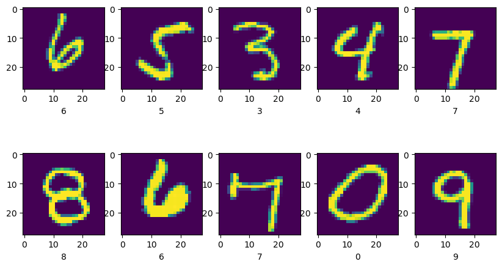
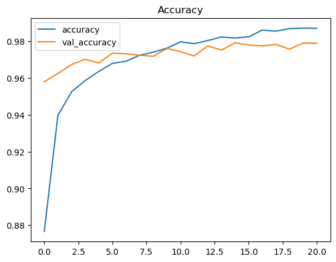

# Digit Recognizer

Recognizing handwritten digits from the MNIST dataset with a simple fully connected neural network in Keras.

| Training examples | Accuracy during training |
|---|---|
|  |  |

## The competition

[Digit Recognizer](https://www.kaggle.com/competitions/digit-recognizer), Kaggle's getting-started competition on MNIST: 28×28 grayscale images of the digits 0 to 9, scored with accuracy.

## Approach

- Pixel values scaled to [0, 1] and a train/validation split.
- A dense network (no convolutions) trained with Keras, with several runs compared on their loss and accuracy curves.

## Results

About 98% accuracy on the validation set and a Kaggle score of 0.98132.

## Files

- [digit-recognizer-with-simple-ann.ipynb](digit-recognizer-with-simple-ann.ipynb): the full notebook, also on Kaggle.
