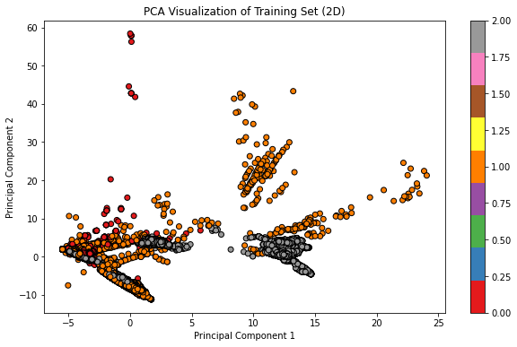
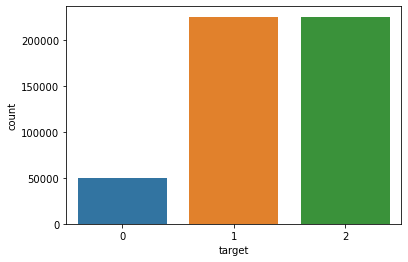

# IoT Botnet Detection (EAIC Data Competition V2)

Classifying IoT network traffic into three classes for botnet detection, with feature selection, PCA and gradient-boosted trees.

| Training data in 2D (PCA) | Class balance |
|---|---|
|  |  |

## The competition

The second data competition of the ENSIAS AI Club (2024). The training set has 499,548 rows and 115 statistical features of network traffic; the test set has 60,000 rows. Two of the three classes have 225,000 rows each and the third 49,548.

## Approach

- 10-fold stratified cross-validation (`src/create_folds.py`).
- Feature reduction: variance threshold, correlation filtering, mutual information (`src/feature_selection*.py`, `src/train_mutual_info.py`) and PCA (`src/pca.py`, `notebooks/pca_implementation.ipynb`).
- Models (`src/model_dispatcher.py`): XGBoost, LightGBM, CatBoost, random forest, extra trees, scikit-learn gradient boosting, SVM and a decision tree. Logistic regression and a small neural network were also tried.
- Hyperparameter searches for XGBoost (`notebooks/xgb-gp-minimize-py.ipynb`) and the random forest (`src/rf_hyperopt.py`, `src/rf_hyperparams_tuning.py`).
- `src/inference.py` combines the fold models by majority vote.

## Files

| Path | Content |
|---|---|
| `notebooks/` | data exploration, PCA and XGBoost tuning notebooks |
| `src/` | folds, feature selection, PCA, training, tuning and inference scripts |
| `output/` | every submission tried |
| `media/` | images for this README |

The competition data (`input/`) and the trained models (`models/`) are not included.

## References

Papers I read during the competition:

- *Dimensionality Reduction for Machine Learning Based IoT Botnet Detection*.
- *In-Depth Feature Selection for the Statistical Machine Learning-Based Botnet Detection in IoT Networks*.
- Rishabh Gandhi, *Comparing Machine Learning and Deep Learning for IoT Botnet Detection*, MSc project, California State University San Marcos, 2021.
