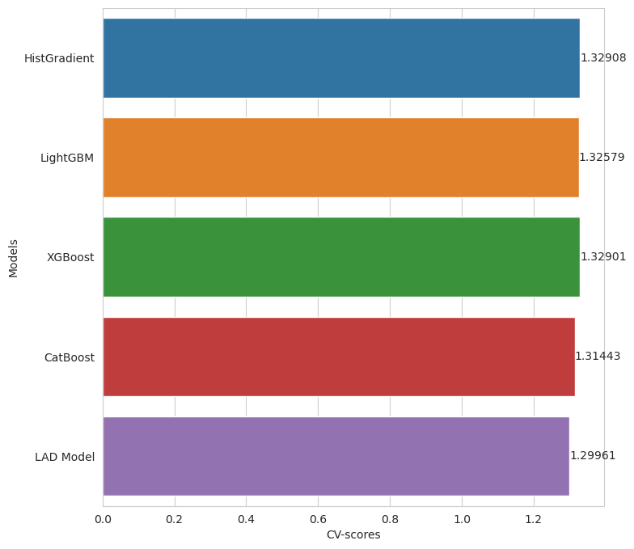
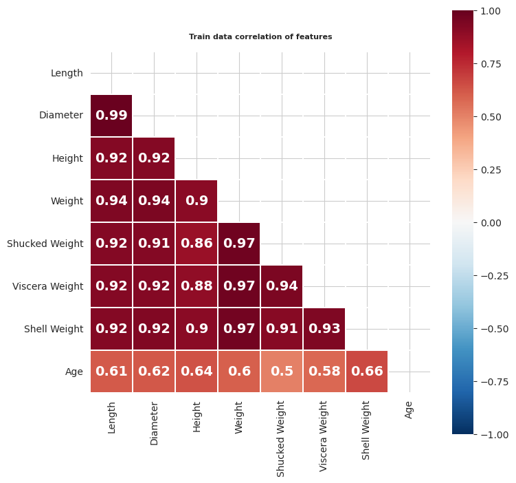

# Crab Age Prediction

Predicting the age of crabs from their physical measurements, with gradient-boosted trees blended by a least-absolute-deviation model.

| Cross-validated MAE by model | Feature correlations |
|---|---|
|  |  |

## The competition

[Regression with a Crab Age Dataset](https://www.kaggle.com/competitions/playground-series-s3e16), episode 16 of season 3 of the Kaggle Playground Series (2023). The data has the crab's sex, length, diameter, height and several weights; submissions are scored with the mean absolute error (MAE) on age.

## Approach

- Exploration of the competition data next to the original crab age dataset it was generated from, split by sex.
- Feature engineering on the measurements and weights.
- HistGradientBoosting, LightGBM, XGBoost and CatBoost regressors, then a least-absolute-deviation (LAD) model that blends their predictions.

## Results

The LAD blend has the best cross-validated MAE, 1.300; the single models score between 1.314 and 1.329.

## Files

- [crab-age-predictions-eda-f-e-modeling-10th.ipynb](crab-age-predictions-eda-f-e-modeling-10th.ipynb): the full notebook, also on Kaggle.
