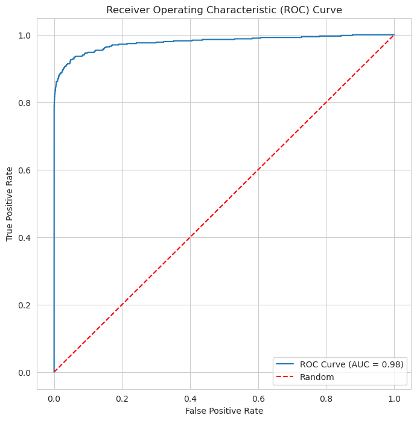
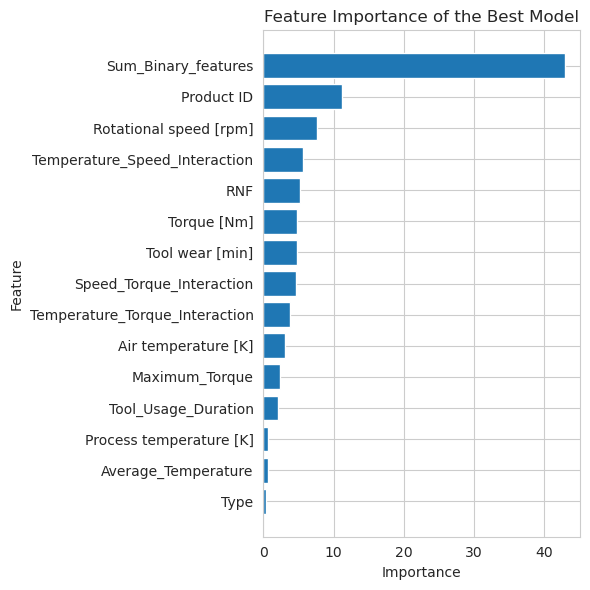

# Machine Failure Prediction

Predicting machine failures from sensor readings with CatBoost, engineered features and Bayesian hyperparameter tuning.

| ROC curve | Feature importance |
|---|---|
|  |  |

## The competition

[Binary Classification of Machine Failures](https://www.kaggle.com/competitions/playground-series-s3e17), episode 17 of season 3 of the Kaggle Playground Series (2023). Each row is a machine with its type, air and process temperatures, rotational speed, torque, tool wear and five failure-mode flags; submissions are scored with the area under the ROC curve (AUC).

## Approach

- Exploration of the competition data and of the original dataset, including the strong class imbalance.
- New features: the sum of the failure-mode flags and interactions between temperature, speed and torque.
- CatBoost, tried with SMOTE oversampling and bagging, then tuned with Bayesian optimization and checked with stratified k-fold.

## Results

The tuned CatBoost reaches a cross-validated AUC of 0.979. The sum of the failure-mode flags is by far its most important feature.

## Files

- [ps3-e17-machine-failures-catboost-top-6.ipynb](ps3-e17-machine-failures-catboost-top-6.ipynb): the full notebook, also on Kaggle.
