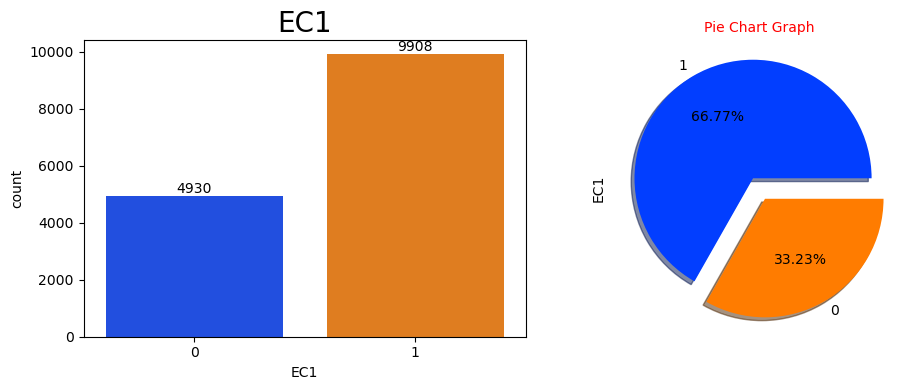
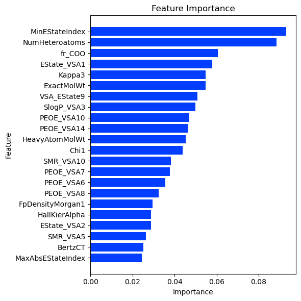

# Enzyme Substrate Classification

Predicting two enzyme classes (EC1 and EC2) of molecules from their chemical descriptors, with a multi-output XGBoost classifier.

| EC1 class balance | Feature importance |
|---|---|
|  |  |

## The competition

[Multi-Label Classification with an Enzyme Substrate Dataset](https://www.kaggle.com/competitions/playground-series-s3e18), episode 18 of season 3 of the Kaggle Playground Series (2023). Each molecule is described by chemical descriptors such as `BertzCT` and the `Chi` indices; submissions are scored with the AUC averaged over EC1 and EC2.

## Approach

- Exploration of the descriptors and of both targets.
- A basic XGBoost baseline on an 80/20 split.
- An improved version: scikit-learn's `MultiOutputClassifier` wrapping XGBoost, validated over 21 multi-label stratified folds.

## Results

The improved model reaches a mean out-of-fold AUC of 0.677 and a Kaggle score of 0.64205.

## Files

- [ps3-e18-eda-multioutputclassifier-xgb-baseline.ipynb](ps3-e18-eda-multioutputclassifier-xgb-baseline.ipynb): the full notebook, also on Kaggle.
