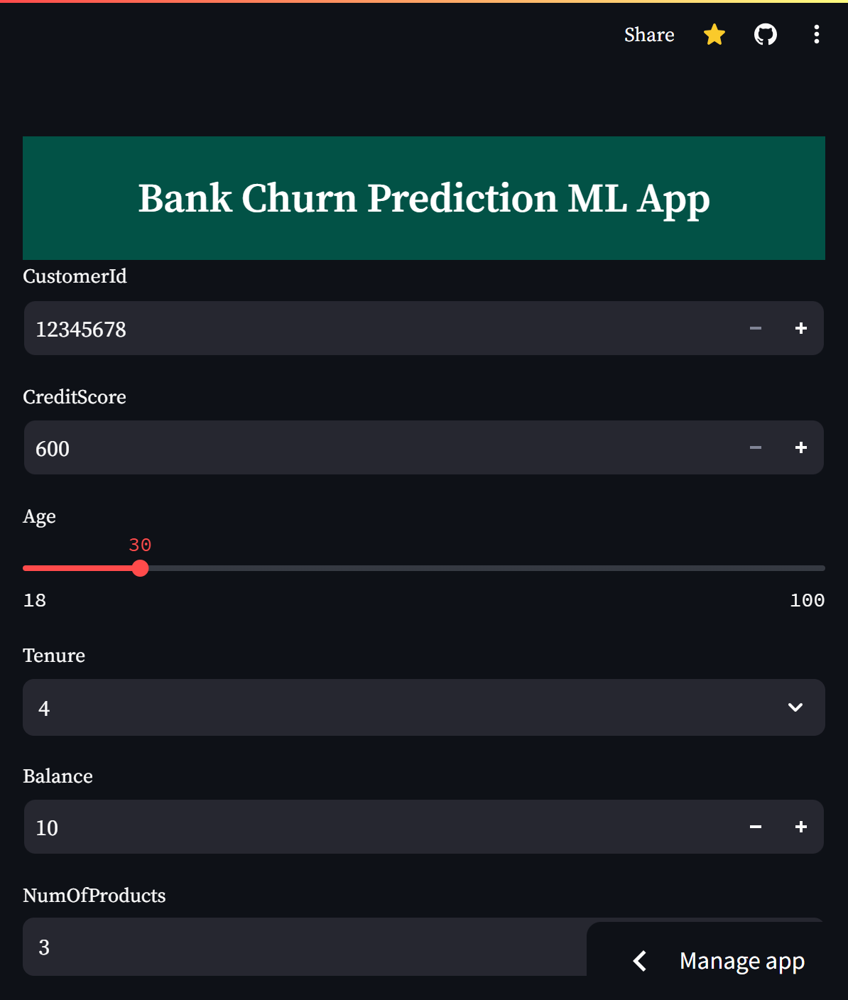
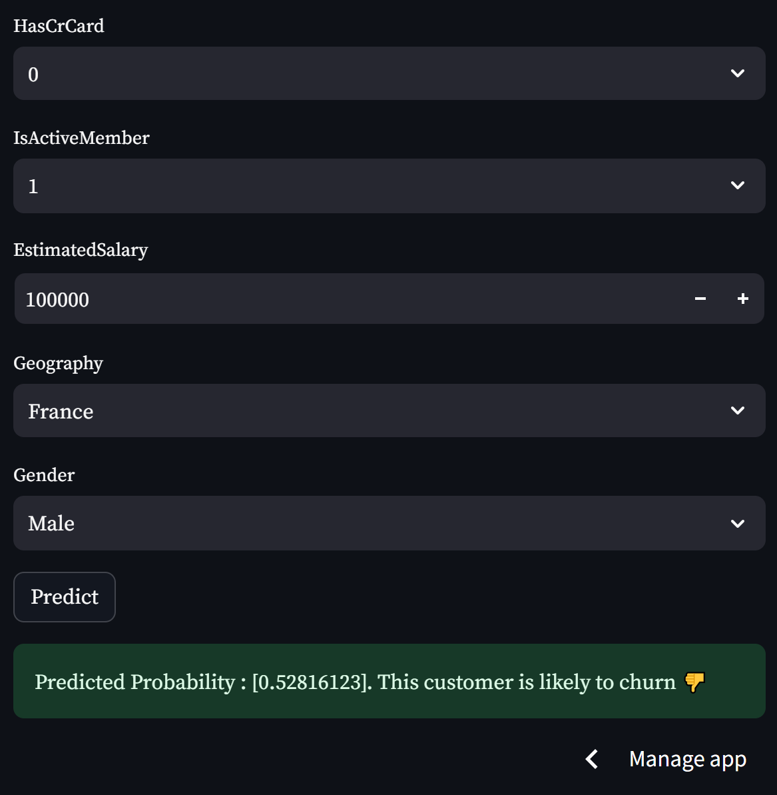
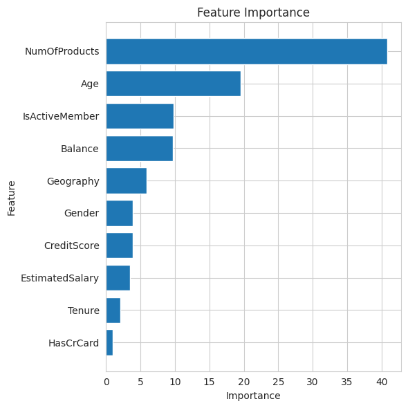

# Bank Churn Prediction

[](https://www.kaggle.com/code/waalbannyantudre/ps4-ep1-bank-churn-eda-catboost-baseline)

Predicting whether a bank customer will close their account, with an ensemble of gradient-boosted trees served in a Streamlit app.

<p align="center">
  
  &nbsp;
  
</p>

## The competition

[Binary Classification with a Bank Churn Dataset](https://www.kaggle.com/competitions/playground-series-s4e1), episode 1 of season 4 of the Kaggle Playground Series (January 2024). Each customer has a credit score, country, gender, age, tenure, balance, number of products, card and activity flags and an estimated salary; submissions are scored with the area under the ROC curve (AUC). The data was generated from the [Bank Customer Churn](https://www.kaggle.com/datasets/shubhammeshram579/bank-customer-churn-prediction) dataset.

## Approach

- 5-fold stratified cross-validation (`src/create_folds.py`).
- Five tree-based models: XGBoost, LightGBM, CatBoost, HistGradientBoosting and GradientBoosting (`src/model_dispatcher.py`), with a target-encoding variant (`src/train_target_encoding.py`).
- Hyperparameter search for HistGradientBoosting (`src/hist_grid_searchCV.py`).
- An average of the five models over the five folds (`src/inference.py`), also used by the Streamlit app (`app.py`).

I published a [CatBoost baseline notebook](https://www.kaggle.com/code/waalbannyantudre/ps4-ep1-bank-churn-eda-catboost-baseline) early in the competition; the [winning solution](https://www.kaggle.com/competitions/playground-series-s4e1/discussion/472502) also relied on CatBoost alone.

<p align="center">
  
</p>

## Results

| Leaderboard | AUC |
|---|---|
| Public | 0.88666 |
| Private | 0.88938 |

## Files

| Path | Content |
|---|---|
| `notebooks/` | data exploration and the CatBoost baseline notebook |
| `src/` | folds, training, target encoding, tuning and inference scripts |
| `output/` | submission files |
| `app.py` | the Streamlit app |
| `media/` | images for this README |

The competition data (`input/`) and the trained models (`models/`) are not included.

## Run it

```bash
git clone https://github.com/anyantudre/kaggle-portfolio
cd kaggle-portfolio/competitions/playground-s4e1-bank-churn
pip install -r requirements.txt
```

Download `train.csv`, `test.csv` and `sample_submission.csv` from the [competition page](https://www.kaggle.com/competitions/playground-series-s4e1/data) into an `input/` folder. Then train the five models the app uses on each fold and start the app:

```bash
cd src
python create_folds.py
for m in hist cat gbm lgbm xgb; do for f in 0 1 2 3 4; do python train.py --fold $f --model $m; done; done
cd ..
streamlit run app.py
```
