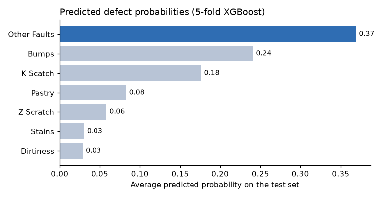

# Steel Plate Defect Prediction

Predicting seven types of surface defect on steel plates from their measurements, with tuned XGBoost models trained on engineered features.

  

## The competition

[Steel Plate Defect Prediction](https://www.kaggle.com/competitions/playground-series-s4e3), episode 3 of season 4 of the Kaggle Playground Series (March 2024). Each plate has geometric, luminosity and material measurements; the task is to give a probability for each of seven defects (Pastry, Z Scratch, K Scatch, Stains, Dirtiness, Bumps and Other Faults), scored with the AUC averaged over the seven.

## Approach

- 5-fold multi-label stratified cross-validation (`src/create_folds.py`).
- New features from the measurements: coordinate ranges, luminosity range and size ratios (`src/feature_eng.py`).
- Gradient-boosted trees: XGBoost, LightGBM, HistGradientBoosting and GradientBoosting (`src/model_dispatcher.py`).
- XGBoost hyperparameter search (`src/xgb_huperparams_opt.py`); the tuned model is trained on each fold by `src/run.sh`.
- `src/inference.py` averages the fold models into `output/xgb_submission.csv`. The chart above shows these predictions: Other Faults and Bumps are the defects the model expects most often.

## Files

| Path | Content |
|---|---|
| `src/` | folds, feature engineering, training, tuning and inference scripts |
| `output/` | the submission file |
| `media/` | images for this README |

The competition data (`input/`) and the trained models (`models/`) are not included.

## Run it

Download `train.csv`, `test.csv` and `sample_submission.csv` from the [competition page](https://www.kaggle.com/competitions/playground-series-s4e3/data) into an `input/` folder next to `src/`, and install `pandas scikit-learn xgboost lightgbm iterative-stratification`. Then, from `src/`:

1. `python create_folds.py` and `python feature_eng.py` prepare the folds and the engineered features.
2. `python train.py --fold N --model NAME` trains one model on one fold; `run.sh` does it for the five folds of the tuned XGBoost.
3. `python inference.py` averages the fold models of the model named at its top and writes the submission.
