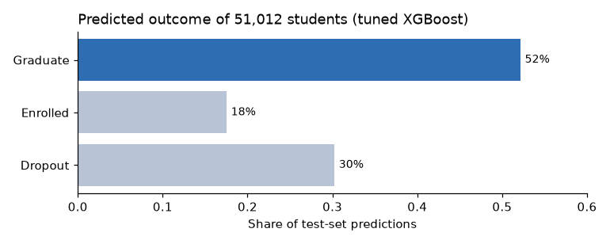
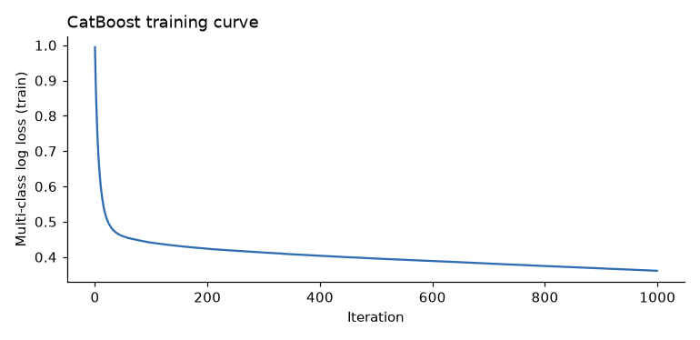

# Academic Success Prediction

Predicting whether a student drops out, stays enrolled or graduates, with tuned XGBoost models, target encoding and an ensemble over folds.

| Predicted outcomes on the test set | CatBoost training curve |
|---|---|
|  |  |

## The competition

[Classification with an Academic Success Dataset](https://www.kaggle.com/competitions/playground-series-s4e6), episode 6 of season 4 of the Kaggle Playground Series (June 2024). Each student has enrolment, demographic, socio-economic and first-year grade information; submissions are scored with accuracy.

## Approach

- 7-fold stratified cross-validation (`src/create_folds.py`).
- XGBoost, LightGBM, CatBoost and scikit-learn gradient boosting (`src/model_dispatcher.py`), with and without mean target encoding of the categorical columns (`src/utils.py`).
- Three tuned XGBoost configurations and a grid search for HistGradientBoosting (`src/hist_grid_searchCV.py`).
- `src/inference.py` averages the target-encoded fold models and writes the submissions in `output/`. The left chart shows the predicted outcomes of the 51,012 test students for one of them: about half are predicted to graduate.

## Files

| Path | Content |
|---|---|
| `src/` | folds, target encoding, training, tuning and inference scripts |
| `output/` | submission files |
| `media/` | images for this README |

The competition data (`input/`) and the trained models (`models/`) are not included.

## Run it

Install the dependencies with `pip install -r requirements.txt` and download `train.csv`, `test.csv` and `sample_submission.csv` from the [competition page](https://www.kaggle.com/competitions/playground-series-s4e6/data) into an `input/` folder next to `src/`. Then, from `src/`:

1. `python create_folds.py` creates the folds.
2. `python train.py --fold N --model NAME` trains one model on one fold; `run.sh` does it for the five first folds of XGBoost.
3. `python inference.py` averages the target-encoded fold models and writes the submission.
